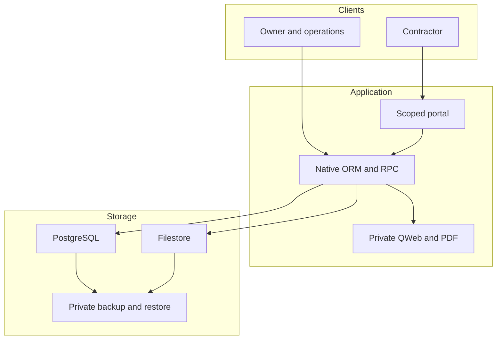

## Executive summary

The main risks are crossing the contractor/operations/finance boundaries through alternate ORM or file routes, changing governed workflow evidence, retaining photo metadata, and carrying development defaults into real hosting. The review reproduced application authorization/integrity defects and adds focused fixes and regressions. It does not certify the framework, dependencies or a production deployment.

## Scope and assumptions

- Baseline: `24d22c3034a1819c5b35667f60a4ef29296113ba`, including merged monthly statement PR #14. Dedicated branch: `feature/security-hardening`; prior work preserved in its original checkout. No AGENTS.md exists in this repository.
- Owner confirmed **pilot with synthetic data** during this review. No dynamic attacks, credential changes or access changes against the shared Codespace or third parties. No production environment has been supplied.
- In scope: custom addon, native APIs used by it, repository history, dev container, CI, test data and restore tooling. Native Odoo source inspected selectively, not a complete framework audit. The original Hebrew specification (`מסמך8.pdf`, sections 1–6), current README, design system and coverage/statement documents informed the requirements; newer explicit business decisions take precedence.
- Odoo Community 18 verified in manifest/runtime source. Local framework source: `60fdb530c0eaf38b46600e772156b39a83578d81`; PostgreSQL 16.15/Python 3.12 in an isolated loopback cluster. This differs from the official Docker image; CI records its own runtime inventory. Version number alone does not establish patch status.
- Morning PR #9 remains separate (`3e696af51952174b369cf2bc7d7d6ce94e1ca193`): configuration/client code inspected statically for secret locations and outbound boundaries, not integrated, dynamically tested or security-approved here. Main has no active Morning credential model or outbound client.
- Open decisions before real use: hosting/operator, allowed internal CRM/project readers, backup destination/encryption/RPO/RTO, retention/erasure obligations and incident owner. No legal retention interval is assumed.

## System model

### Primary components

Python addon `field_work_photos` extends CRM, Project, Contacts and Portal. PostgreSQL stores jobs, main/extra image bytes, immutable payments and entitlement events. Odoo's filestore stores ordinary attachments/assets. Transient models hold payment/correction dialogs and private statement snapshots. QWeb/wkhtmltopdf renders the same statement payload used on screen (`models/contractor_statement.py`, `report/contractor_statement_templates.xml`).

The pilot launcher generates local credentials, initializes Hebrew data/accounts and runs a development HTTP service (`scripts/pilot.py`). It is an initialization tool with privileged writes, not a production service definition. GitHub Actions runs synthetic integration/browser tests. Repository and CI artifacts are public; backups/credentials must never be uploaded to them.

### Data flows and trust boundaries

- Browser → portal controller: authenticated HTTP, session cookie, POST CSRF token, fixed field allowlist, current contractor/company/active-job domain and recheck after parent locks. `controllers/field_portal.py:_task`, `field_work_report`.
- Internal browser/API → ORM: native session/RPC, ACLs, global record rules, field groups and explicit public-action checks. Context/default values are attacker-controlled input, not trusted application state. `security/*.xml`, `models/*:create/write/action_*`.
- Scoped portal → elevated task ORM: narrowly selected task, explicit fields and parent locking. Never accepts a client-supplied company/user for authorization. Sudo records remain private to controller rendering/mutation.
- ORM → PostgreSQL: native ORM for data; fixed parameterized SQL only for ordered row locks. `field_dispatch.py:_lock_dispatch_work`, `field_collection.py:_lock_collection`. SQL is not a substitute for ACL checks.
- Photo input → Pillow → stored image: base64/byte/pixel/frame/format/count limits, orientation handling, downsize and metadata-free re-encoding. Existing image rows are not rewritten on upgrade.
- Statement → QWeb/PDF engine: finance/creator/active-company checks on the snapshot and provider; server-generated relative source links, escaped text, static local font. No contractor-controlled URL, HTML or stylesheet is fetched by this custom report. Native PDF assets/base URL remain operator-controlled; production PDF egress policy still needs deployment verification.
- Database plus filestore → private backup → new restore DB: offline pilot lock, pg_dump, matching file copy, separate randomly named target, count and checksum verification. This is a drill, not scheduled/off-site/encrypted production backup.
- Git → CI → artifacts: immutable action SHAs, read-only workflow permissions, no persisted checkout credentials, synthetic-only artifacts with explicit retention. Scanner tools receive source/package metadata, not customer data or runtime secrets.

#### Diagram

## Assets and security objectives

| Asset | Why it matters | Objective |
|---|---|---|
| Customer contact/location/access instructions | Customer and site privacy | C/I |
| Before/after images and attachments | Private sites, individuals, device/GPS metadata | C/I/A |
| Contractor rates, margins, gross agreements and payouts | Commercial confidentiality and financial correctness | C/I |
| Receipt/entitlement history and approval identities | Reconciliation, correction and attribution | I/A |
| Sessions, generated credentials, future Morning secrets | Ability to impersonate privileged actors | C/I |
| DB, filestore and backups | Recovery requires all three in a consistent state | C/I/A |
| Source, toolchain and CI artifacts | Supply-chain trust and accidental disclosure | C/I/A |

## Attacker model

### Capabilities

Guest can send unauthenticated requests. A contractor can change URLs, identifiers, form fields/files and make direct RPC calls. An operations/internal user can exercise granted native APIs and tamper with values/context. A former contractor can retain an old URL or session. Two authenticated sessions can send concurrent requests. Text and image contents are untrusted even when uploaded by an authorized user.

### Non-capabilities

Do not assume an external attacker can edit server Python, replace action code, read Codespace files or become a trusted system administrator. Operators with DB/filesystem/superuser access can bypass application controls; this review does not claim protection against a malicious host administrator. No sustained DoS, credential guessing campaign or third-party scanning was conducted.

## Entry points and attack surfaces

| Surface | How reached | Boundary | Evidence |
|---|---|---|---|
| List/detail/report/photo portal | `/my/field-work` and task subroutes | Contractor → scoped sudo | `controllers/field_portal.py` |
| Native read/search/write/export/actions | JSON-RPC and Odoo UI | Internal/portal → ORM | `models/*.py`, `security/*.xml` |
| Native binary/attachment routes | `/web/image`, `/web/content`, direct attachment ID | Guest/session → resource | Odoo `ir.binary`, `web.controllers.binary`; new HttpCase tests |
| HTML/PDF/download | `/report/html`, `/report/pdf`, `/report/download` | Session → private snapshot | report provider and `controllers/contractor_statement.py` |
| Files/images | Multipart or binary ORM values, including defaults | Parser → DB | `project_task.py`, `field_visit.py` |
| Pilot bootstrap/DB manager | Launcher or native admin routes | Operator → privileged state | `scripts/pilot.py`, native Odoo deployment controls |
| CI/history/artifacts | GitHub PR/push | Contributor → build/toolchain | `.github/workflows/*.yml` |

## Top abuse paths

1. Contractor changes a task/photo ID → scoped ownership check rejects → native binary paths must not provide an alternate route.
2. Removed contractor retains a URL → current assignment is checked again → neither old detail nor old photo remains authorized.
3. Operations searches transient payment dialogs → private draft amounts would cross the finance boundary → creator/company/kind rules close that path.
4. Authenticated creator injects defaults → validation sees incomplete explicit values → governed creation checks must inspect effective values or remove protected defaults.
5. Internal user adds photos to an approved job through an alternate creation path → parent lock/state/count validation must run on its effective parent.
6. Authorized uploader supplies metadata-bearing or malformed image → only approved decoders and bounded, metadata-free output should be stored.
7. Two sessions spend the same balance or repeat a dialog → lead locks and uniqueness/idempotency must preserve one financial outcome.
8. User prints/exports instead of reading a protected form → identical native ACL/field/provider checks must remain effective.
9. Operator copies only the DB or uploads a backup to public CI → recovery/privacy fail despite correct application ACLs.

## Threat model table

| ID | Source | Prerequisite | Action | Impact/assets | Existing controls | Gap/status | Mitigation | Detection | Likelihood | Impact severity | Priority |
|---|---|---|---|---|---|---|---|---|---|---|---|
| TM-001 | Contractor/guest | Known/guessed IDs | Cross-job binary/document access | Customer/photos C | Scoped domain, native deny rules | Tested allowed/denied routes; limited token paths | Keep authorization per resource, no-store | Denied request patterns without payloads | medium | high | high |
| TM-002 | Operations | Granted dialog ACL | Read another user's private payout draft | Financial C | Ledger kind/field protection | Confirmed S-001, fixed | Creator/company/kind rules and action checks | Regression/denial logs | high | high | high |
| TM-003 | Internal API caller | Create rights | Inject protected/default parent values | Workflow/audit/pricing I | Explicit create guards | Confirmed S-002/S-003, fixed | Protect defaults, validate effective values under locks | Regression tests | medium | medium | medium |
| TM-004 | Uploader | Valid account | Send malicious/oversized/metadata image | Privacy/A | Format/12MB/50MP/count bounds | Metadata retention fixed; parser dependency triage open | Whitelisted decoders/re-encode; maintained image libraries | Reject counts/worker resource metrics | medium | medium | medium |
| TM-005 | Two sessions | Same payable job | Duplicate/overconsume balance | Financial I | Ordered locks, uniqueness, request key | Controlled two-session checks added | Keep invariants in server transactions | Payment/event anomaly alerts | medium | high | high |
| TM-006 | Guest/form sender | Session/forged link | CSRF, XSS or report escalation | Customer/session/finance C/I | CSRF, escaping, provider/field checks | New direct HTTP tests; caching hardened | No raw untrusted markup; private report response | CI negative tests | medium | high | high |
| TM-007 | Build compromise | Contributor/tool access | Leak keys or change dependencies | Credentials/source C/I | Minimal workflow permissions | No detected history secrets; mutable images/dependency triage remain | Pinned actions, redacted scanners; patch/rebuild policy | CI artifacts/advisories | medium | high | high |
| TM-008 | Loss/operator error | Real hosting | Lose DB/files or expose backups | All C/I/A | Private local files, DB filter | No production recovery plan | Separate encrypted backups, tested restore, RPO/RTO | Restore drills and backup monitoring | high | high | high |

## Criticality calibration

Critical: unauthenticated broad data/credential extraction or remote code execution. High: reproducible contractor/company isolation failure or operations reading protected financial information. Medium: authenticated workflow/locking bypass or bounded resource/privacy impact. Low: secondary metadata/cache exposure under existing authorization or a defense-in-depth control gap. A pilot-only development choice is a deployment constraint, not automatically a production vulnerability. No critical vulnerability was verified in the reviewed scope.

## Focus paths for security review

| Path | Reason | Threats |
|---|---|---|
| `controllers/field_portal.py` | Narrow elevated ownership and upload boundary | 001, 004, 006 |
| `models/project_task.py`, `models/field_visit.py` | Image validation, defaults, locked state, parent scope | 003, 004 |
| `models/field_dispatch.py`, `models/field_workspace.py` | Assignment, linked-task creation, review actions | 001, 003 |
| `models/field_pricing.py` | Private fields and immutable historical rates | 002, 003 |
| `models/field_collection.py`, `models/field_entitlement.py` | Monetary invariants and append-only evidence | 002, 005 |
| `models/contractor_statement.py`, `report/`, `controllers/contractor_statement.py` | Export/PDF authorization, escaping and snapshots | 002, 006 |
| `security/` | Global deny/company/private rules and ACL composition | 001, 002, 003 |
| `scripts/pilot.py`, `.devcontainer/` | Bootstrap secrets and non-production runtime | 007, 008 |
| `.github/workflows/`, security scripts | Build trust, scanner evidence and restore | 007, 008 |

## Notes on use

Entrypoints, trust boundaries, runtime vs CI/dev and the user's pilot confirmation are covered above. Remaining assumptions are explicit; threat stories are not claims of confirmed vulnerabilities. See `findings.md`, `permissions.md`, `verification.md` and `operations.md` for reproducible test names, results and deployment gates. This public-safe model contains no credentials, customer data or live exploitation recipe.
